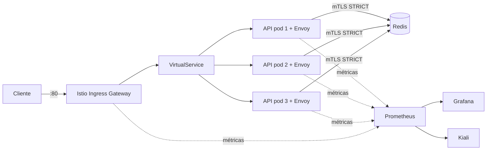
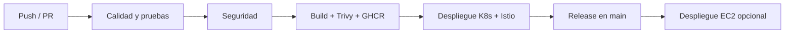

# 🎯 Perfumes API — EP3 DevOps

Microservicio de catálogo de perfumes (Node.js + Express) con pipeline CI/CD completo, contenedores, análisis de seguridad, despliegue en Kubernetes con Istio, observabilidad (Prometheus, Grafana, Kiali) y políticas de cumplimiento automatizadas.


[](https://github.com/Moonlighpoio/perfumes-api/releases)
[](https://github.com/Moonlighpoio/perfumes-api/pkgs/container/perfumes-api)

---

## 📌 Descripción

API REST que permite listar, filtrar, buscar, ordenar y crear perfumes. El objetivo del EP3 es automatizar el ciclo de vida del microservicio: **código → pruebas → análisis de seguridad → imagen → despliegue → verificación**, con trazabilidad desde el commit hasta el entorno desplegado.

| Componente | Tecnología |
|---|---|
| Runtime | Node.js 24 |
| Framework | Express 5 |
| Pruebas | Jest + Supertest |
| Calidad | ESLint + umbral de cobertura |
| Contenedores | Docker multi-stage (non-root) |
| Orquestación | Kubernetes (k3s en EC2, kind en CI) + Istio |
| Observabilidad | Prometheus + Grafana + Kiali |
| Seguridad de malla | mTLS STRICT + AuthorizationPolicy (default-deny) |
| CI/CD | GitHub Actions |
| Seguridad | Dependabot + `pnpm audit` + Snyk + Trivy + CodeQL + `istioctl analyze` |
| Registro de imágenes | GitHub Container Registry (GHCR) |

---

## 🏗️ Arquitectura



- **Istio** es el punto de entrada y gestiona el tráfico, el cifrado mTLS y la telemetría.
- La **API** corre con 3 réplicas (pods) y cada una lleva un sidecar Envoy inyectado por Istio.
- El catálogo se persiste en **Redis**, accedido solo dentro de la malla.
- Cada pod tiene probes, límites de CPU/memoria, filesystem de solo lectura y `cap_drop: ALL`.
- **Prometheus** recolecta métricas de Envoy, **Grafana** las grafica y **Kiali** muestra la topología.

> Detalle completo de la integración y las decisiones técnicas: [`docs/ep3-observabilidad.md`](docs/ep3-observabilidad.md).

---

## 🔌 Endpoints

| Método | Endpoint | Descripción |
|---|---|---|
| GET | `/` | Información básica del servicio |
| GET | `/health` | Estado del servicio y versión |
| GET | `/perfumes` | Lista, filtra, busca y ordena perfumes |
| GET | `/perfumes/:id` | Obtiene un perfume por ID |
| POST | `/perfumes` | Crea un perfume |

### Query params de `GET /perfumes`

| Param | Descripción | Ejemplo |
|---|---|---|
| `category` | Filtra por categoría | `?category=femenino` |
| `search` | Busca por nombre (sin distinguir mayúsculas) | `?search=chanel` |
| `sort` | Ordena por precio (`price_asc` / `price_desc`) | `?sort=price_asc` |

### Ejemplos

```bash
curl http://localhost:3000/health
curl http://localhost:3000/perfumes
curl "http://localhost:3000/perfumes?category=femenino&search=chanel&sort=price_asc"
curl http://localhost:3000/perfumes/1

curl -X POST http://localhost:3000/perfumes \
  -H "Content-Type: application/json" \
  -d '{"name":"Bleu de Chanel","brand":"Chanel","price":119990,"category":"masculino","stock":5}'
```

---

## 🚀 Ejecución local

### Con Node.js

```bash
pnpm install
pnpm dev        # desarrollo con nodemon
pnpm start      # producción
pnpm test       # pruebas
pnpm test:ci    # pruebas + cobertura + umbral
pnpm lint       # análisis estático
```

### Con Docker

```bash
docker build -t perfumes-api:local .
docker run --rm -p 3000:3000 perfumes-api:local
```

### Con Docker Compose

```bash
docker compose up -d --build --wait
docker compose ps
pnpm smoke
docker compose down -v
```

El gateway queda disponible en `http://localhost:3000`.

### Con Kubernetes + Istio (EP3)

```bash
docker build -t perfumes-api:local .
bash scripts/k8s-local.sh perfumes-api:local
```

El script crea un cluster `kind`, instala Istio, despliega la API y Redis, instala
Prometheus/Grafana/Kiali, valida la malla con `istioctl analyze` y ejecuta el smoke test
a través del ingress gateway (`http://localhost:3000`).

Dashboards:

```bash
istioctl dashboard kiali
istioctl dashboard grafana
istioctl dashboard prometheus
```

---

## 🔄 Pipeline CI/CD

Workflow: [`.github/workflows/ep2.yml`](.github/workflows/ep2.yml)

Se ejecuta en **push a `develop`/`main`**, **pull requests** y manualmente (`workflow_dispatch`). Los jobs se encadenan con `needs`, por lo que un fallo detiene las etapas siguientes.

| # | Job | Qué hace | Gate |
|---|---|---|---|
| 1 | **Calidad y pruebas** | `pnpm lint`, Jest + Supertest, cobertura, métricas en Step Summary | Falla si lint o tests fallan, o si la cobertura baja de 90% |
| 2 | **Seguridad** | `pnpm audit --prod`, Snyk Open Source, Snyk Code (SAST), CodeQL | Falla con vulnerabilidades altas/críticas |
| 3 | **Imagen Docker** | Build multi-stage, escaneo Trivy, artefacto, push a GHCR | Falla si Trivy detecta HIGH/CRITICAL corregibles |
| 4 | **Despliegue K8s + Istio** | Cluster kind, Istio, 3 réplicas, Prometheus/Grafana/Kiali, `istioctl analyze` y smoke tests | Falla si la malla es inválida o el entorno no responde |
| 5 | **Release** (solo `main`) | Crea tag y release `vX.Y.Z` | Trazabilidad versión → commit |
| 6 | **Despliegue EC2** (opcional) | k3s + Istio en EC2 vía SSM | Falla si el rollout o `istioctl analyze` fallan |

### Flujo



### Política de calidad (IE2)

- **32 pruebas automatizadas** con Jest + Supertest sobre la app real.
- Cobertura mínima bloqueante: **90%** en statements, branches, functions y lines (`jest.config.js`).
- ESLint con `no-undef` como error.
- Smoke tests de integración contra el entorno desplegado (`scripts/smoke-test.mjs`).

### Política de seguridad (IE3)

- **Dependabot** semanal para npm, Docker y GitHub Actions (`.github/dependabot.yml`).
- **`pnpm audit --prod`** bloqueante en cada ejecución.
- **Snyk Open Source** para dependencias (`snyk test`), bloqueante con severidad `high`.
- **Snyk Code** para análisis estático (`snyk code test`), bloqueante con severidad `high` (0 hallazgos en el último análisis).
- **CodeQL** analiza el código JavaScript/TypeScript en cada push, PR y semanalmente, y publica los hallazgos en la pestaña *Security*.
- **Trivy** escanea la imagen construida y publica resultados SARIF en la pestaña *Security*.
- **Bloqueo real**: `docker` depende de `security`; `deploy` depende de `docker`. Si la seguridad falla, no se construye ni despliega.
- Hardening de contenedores: usuario no-root, `read_only`, `cap_drop: ALL`, `no-new-privileges`, límites de recursos y healthchecks.

> `SNYK_TOKEN` está configurado. Snyk Open Source y Snyk Code se ejecutan en cada pipeline; si no existiera el secreto, el pipeline seguiría funcionando con `pnpm audit` + Trivy y mostraría una advertencia.

### Escalabilidad y orquestación (IE2 / IE3)

- **3 réplicas** de la API como pods de Kubernetes, balanceadas por Istio (`ROUND_ROBIN`).
- `DestinationRule` con `connectionPool` y `outlierDetection` (expulsa pods con 5xx).
- El catálogo se persiste en **Redis compartido**, por lo que todos los clientes ven el mismo estado.
- Límites y reservas de CPU/memoria por pod, probes de readiness/liveness y `RollingUpdate`.
- Ingress único vía **Istio Gateway + VirtualService**; la API no está expuesta directamente.
- Red segmentada y cifrada con **mTLS STRICT** (IE5).

### Observabilidad (IE1 / IE3)

- **Prometheus** recolecta métricas de Envoy/Istio (`istio_requests_total`, latencia, 5xx).
- **Grafana** muestra CPU/memoria, requests y errores; **Kiali** muestra el grafo de servicios.
- Logs de acceso de Envoy habilitados con el recurso `Telemetry` para auditoría.
- **GitHub Actions Step Summary** publica tiempo de despliegue y cobertura de pruebas en cada run.
- Sin instrumentar el código: la malla genera la telemetría de forma transparente.

### Cumplimiento automatizado (IE5 / IE6)

- `PeerAuthentication` en modo **STRICT**: todo el tráfico entre pods va cifrado.
- `AuthorizationPolicy` **default-deny**: solo el ingress gateway y el monitoreo entran a la API.
- `istioctl analyze` **bloqueante** en el job de despliegue: una mala configuración detiene el pipeline.
- Trivy, `pnpm audit`, Snyk y cobertura ≥ 90% detienen el pipeline antes de desplegar.
- Branch protection en `main` y `develop` con checks obligatorios (`scripts/configure-repo.sh`).

### Despliegue y trazabilidad (IE4)

| Etapa | Evidencia |
|---|---|
| Código | Commit `GITHUB_SHA` |
| Imagen | `ghcr.io/wsk4/perfumes-api:<SHA>` (tag inmutable, publicado en GHCR) |
| Artefacto | `image.tar` publicado en el run (fuente del despliegue) |
| Entorno | `staging` (develop) / `production` (main) con historial de deployments |
| Verificación | Healthcheck + smoke tests contra el gateway |
| Versión | Release/tag `vX.Y.Z` en `main` |

Cada deployment queda asociado al commit y al entorno en GitHub Actions. La imagen se etiqueta con el SHA, por lo que se puede reconstruir o volver a desplegar exactamente la misma versión (rollback: desplegar un SHA anterior).

---

## ⚙️ Configuración del repositorio

Estos pasos se ejecutan **una vez** y requieren permisos de administrador:

```bash
gh auth login
REPO=wsk4/perfumes-api bash scripts/configure-repo.sh
```

El script:

- Configura descripción y topics del repositorio.
- Activa alertas de vulnerabilidades y actualizaciones de seguridad de Dependabot.
- Protege `develop` y `main` exigiendo PR y los checks `Calidad y pruebas`, `Seguridad` e `Imagen Docker`.
- Crea el secreto `SNYK_TOKEN` si se entrega por variable de entorno.

Para configurar Snyk manualmente:

```bash
gh secret set SNYK_TOKEN --repo wsk4/perfumes-api
```

---

## ☁️ Despliegue en AWS EC2 (opcional)

El repositorio incluye infraestructura como código para desplegar en una instancia EC2 real usando **SSM** (sin abrir el puerto SSH).

### Infraestructura
- `infra/terraform/`: crea EC2 (Amazon Linux 2023), Security Group (puerto 80 para Istio), Elastic IP, rol IAM con `AmazonSSMManagedInstanceCore` y bootstrap de Docker/Git.
- El job `deploy-aws` instala **k3s** (sin Traefik) e **Istio**, aplica `src/k8s/` e instala Prometheus/Grafana/Kiali mediante `scripts/deploy-ec2.sh`.

### Requisitos verificables antes del despliegue

La instancia debe estar `Running`, con los dos status checks aprobados, una Elastic IP,
el rol de instancia `AmazonSSMManagedInstanceCore` y conectividad de salida. El workflow
no se habilita hasta que esos requisitos estén comprobados; así se evita registrar como
"desplegado" un entorno que todavía no puede recibir comandos SSM.

### Pasos restantes
1. Adjunta el rol IAM `AmazonSSMManagedInstanceCore` a la instancia.
2. Crea el rol IAM para GitHub OIDC y copia su ARN. El workflow usa credenciales
   temporales OIDC; no requiere secretos AWS de larga duración.
3. En GitHub → Settings → Variables, configura:
   - `ENABLE_AWS_DEPLOY` = `true`
   - `AWS_REGION` = `us-east-1`
   - `AWS_ROLE_ARN` = `arn:aws:iam::<cuenta>:role/perfumes-api-github-deploy`
   - `EC2_INSTANCE_ID` = `<id-de-la-instancia-ec2>`
4. Dispara el workflow manualmente o haz un push a `main`.
5. Verifica `GET /health` en la Elastic IP y conserva la URL como evidencia de la entrega.

### Rol IAM para GitHub OIDC
El rol debe tener una trust policy para `token.actions.githubusercontent.com` con la condición `repo:wsk4/perfumes-api:ref:refs/heads/main` y permisos `ssm:SendCommand`, `ssm:GetCommandInvocation`, `ssm:DescribeInstanceInformation`.

## 🌿 Estrategia de ramificación (GitFlow)

| Rama | Propósito |
|---|---|
| `main` | Producción estable; dispara deploy a `production` y release |
| `develop` | Integración continua; deploy a `staging` |
| `feature/*` | Nuevas funcionalidades |
| `hotfix/*` | Correcciones urgentes desde `main` |

Los merges a `develop` y `main` se realizan por Pull Request con checks obligatorios.

### Convención de commits

`feat:`, `fix:`, `test:`, `ci:`, `docs:`, `chore:`, `refactor:`.

---

## ✅ Evidencias de ejecución

| Fecha | Rama / entorno | Evidencia | Resultado |
|---|---|---|---|
| 2026-10-30 | `develop` / staging | [Run 41021007374](https://github.com/Moonlighpoio/perfumes-api/actions/runs/41021007374) | ✅ Calidad, seguridad, imagen, despliegue (3 réplicas + Redis) |
| 2026-10-30 | `main` / production | [Run 41021010108](https://github.com/Moonlighpoio/perfumes-api/actions/runs/41021010108) | ✅ Pipeline completo + release |
| 2026-10-30 | CodeQL | [develop](https://github.com/Moonlighpoio/perfumes-api/actions/runs/41014265241) / [main](https://github.com/Moonlighpoio/perfumes-api/actions/runs/41014267878) | ✅ 0 alertas abiertas |
| 2026-10-30 | Release | [v2.0.0](https://github.com/Moonlighpoio/perfumes-api/releases/tag/v2.0.0) | ✅ Tag y release creados |
| 2026-10-30 | Imagen | [GHCR](https://github.com/Moonlighpoio/perfumes-api/pkgs/container/perfumes-api) | ✅ Tags `develop`, `main`, `latest` y SHA |

### Verificación local (previa al push)

```
pnpm lint                 -> OK
pnpm test:ci              -> 32/32 pruebas, 100% cobertura
pnpm audit --prod         -> 0 vulnerabilidades
docker build              -> OK (multi-stage, non-root)
trivy image (HIGH/CRIT)   -> 0 vulnerabilidades corregibles
bash scripts/k8s-local.sh -> 3 pods API + Redis + Prometheus/Grafana/Kiali
istioctl analyze          -> 0 errores de configuración
smoke test                -> 11 verificaciones OK
```

---

## 🗺️ Cumplimiento de la rúbrica

| Indicador | Peso | Evidencia |
|---|---|---|
| **IE1** Monitoreo y logging | 20% | Istio + Prometheus + Grafana + Kiali, access logs Envoy, `istioctl analyze` |
| **IE2** Orquestación en la nube | 20% | Kubernetes (k3s/kind), `src/k8s/`, despliegue automatizado vía pipeline y SSM |
| **IE3** Dashboards y métricas | 10% | Grafana (requests, errores, CPU/mem) + Step Summary (tiempo de despliegue, cobertura) |
| **IE4** Documentación | 10% | `docs/ep3-observabilidad.md`, README, diagramas y criterios de decisión |
| **IE5** Políticas de cumplimiento | 20% | mTLS STRICT, AuthorizationPolicy default-deny, Trivy, Snyk, branch protection |
| **IE6** Validación que detiene el pipeline | 20% | Gates bloqueantes: cobertura, Trivy, `pnpm audit`, Snyk, `istioctl analyze` |

---

## 👥 Equipo

| Integrante | GitHub | Rol |
|---|---|---|
| Matias Gonzalez V. | [@wsk4](https://github.com/wsk4) | CI/CD, Docker y seguridad |
| Renato Barriga P. | [@Moonlighpoio](https://github.com/Moonlighpoio) | API, pruebas y orquestación |
| Cristobal Veliz L. | [@Veliz1232](https://github.com/Veliz1232) | Pipeline, despliegue y documentación |

---

## 🤖 Uso de Inteligencia Artificial

Se utilizó IA (OpenCode) como apoyo para: estructura del pipeline, Dockerfile, configuración de Kubernetes e Istio, pruebas automatizadas y redacción técnica del README. **Todo el contenido fue revisado y validado por el equipo.**

La IA **no** se usó para redactar conclusiones, justificaciones técnicas ni reflexiones individuales: esas secciones fueron escritas por el equipo. Las **reflexiones individuales** deben ser redactadas por cada integrante sin apoyo de IA, según la pauta del curso. Referencia: <https://bibliotecas.duoc.cl/ia>.

---

## 📝 Conclusiones y reflexiones individuales

> ⚠️ Cada integrante debe completar su reflexión personal (sin IA): qué aprendió, qué aportó al proyecto y qué dificultad enfrentó.

### Integrante 1 — Matias Gonzalez V. (@wsk4)


### Integrante 2 — Renato Barriga P. (@Moonlighpoio)


### Integrante 3 — Cristobal Veliz L. (@Veliz1232)


---

## 📦 Entrega (AVA y correo)

1. Verificar que el pipeline esté verde en `main`: [Actions](https://github.com/Moonlighpoio/perfumes-api/actions).
2. Subir el enlace del repositorio en AVA.
3. Enviar el enlace por correo al docente dentro del plazo.
4. Adjuntar evidencias: runs verdes, release, imagen GHCR.

## 📄 Licencia

MIT — proyecto académico de Ingeniería DevOps (DOY0101).
