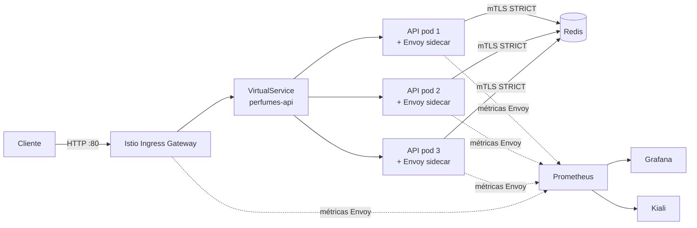

# EP3 — Observabilidad, Kubernetes e Istio

Documento de integración y toma de decisiones técnicas (IE4) para la Evaluación
Parcial N°3 de Ingeniería DevOps.

## 1. Objetivo

Extender el pipeline de la EP2 para que el microservicio no solo se despliegue,
sino que sea **observable**, **medible** y **gobernado**:

- Observabilidad sin instrumentar el código: **Istio** genera métricas, logs y trazas.
- Entorno orquestado en la nube: **k3s** en EC2 (producción) y **kind** en CI (simulación).
- Dashboards: **Grafana** (KPIs de runtime) + **GitHub Actions** (KPIs de CI/CD).
- Cumplimiento: **mTLS STRICT**, default-deny, `istioctl analyze`, Trivy, Snyk y branch protection.
- El pipeline se **detiene** ante fallas críticas de calidad o seguridad.

## 2. Arquitectura



Componentes:

| Capa | Herramienta | Manifiesto / flujo |
|---|---|---|
| Orquestación | Kubernetes (k3s en EC2, kind en CI) | `src/k8s/deployment-api.yaml` |
| Service Mesh | Istio | `src/k8s/istio/gateway-virtualservice.yaml` |
| Seguridad de malla | mTLS + AuthorizationPolicy | `src/k8s/istio/security.yaml` |
| Métricas | Prometheus | addon oficial de Istio |
| Dashboards | Grafana + Kiali | addons oficiales de Istio |
| CI/CD | GitHub Actions | `.github/workflows/ep2.yml` |

## 3. Integración en el pipeline

```
quality ──> security ──> docker ──> deploy (kind + Istio) ──> release ──> deploy-aws (k3s + Istio)
   │            │           │              │
   │            │           │              └─ istioctl analyze (bloqueante)
   │            │           └─ Trivy HIGH/CRITICAL (bloqueante)
   │            └─ pnpm audit + Snyk HIGH (bloqueante)
   └─ ESLint + Jest + cobertura ≥ 90% (bloqueante)
```

Qué ocurre en cada etapa:

1. **quality**: lint, pruebas y umbral de cobertura. Si baja de 90%, el pipeline falla.
2. **security**: `pnpm audit` y Snyk. Una vulnerabilidad alta/crítica detiene el pipeline.
3. **docker**: build + Trivy. Una vulnerabilidad HIGH/CRITICAL en la imagen detiene el pipeline.
4. **deploy**: crea un cluster kind, instala Istio, aplica manifiestos, despliega
   Prometheus/Grafana/Kiali, ejecuta `istioctl analyze` y el smoke test a través del
   ingress gateway. Cualquier fallo detiene el pipeline.
5. **release**: solo en `main`, crea el tag `vX.Y.Z`.
6. **deploy-aws**: solo en `main` y con `ENABLE_AWS_DEPLOY=true`, obtiene credenciales
   temporales mediante GitHub OIDC y despliega en EC2 con k3s + Istio mediante SSM
   (sin abrir SSH ni guardar claves AWS en GitHub).

## 4. Métricas y dashboards (IE3)

| Métrica | Origen | Dónde se visualiza |
|---|---|---|
| Tiempo de despliegue | job `deploy` (segundos) | GitHub Actions → Step Summary |
| Cobertura de pruebas | Jest `coverage-summary.json` | GitHub Actions → Step Summary + artifact |
| CPU / memoria de los pods | cAdvisor / Envoy | Grafana (dashboard Istio) |
| Requests por segundo | `istio_requests_total` | Grafana / Kiali |
| Errores 5xx | `istio_requests_total{response_code=~"5.."}` | Grafana / Kiali |
| Disponibilidad | `up` + readiness probes | Grafana / Kiali |
| Topología y latencia entre servicios | Telemetría Envoy | Kiali (grafo de servicios) |

Consulta de errores en Prometheus:

```promql
sum(rate(istio_requests_total{reporter="destination", response_code=~"5.."}[5m]))
/
sum(rate(istio_requests_total{reporter="destination"}[5m]))
```

## 5. Políticas de cumplimiento (IE5 / IE6)

| Política | Implementación | Efecto |
|---|---|---|
| Cifrado en tránsito | `PeerAuthentication` modo `STRICT` | Todo el tráfico entre pods usa mTLS |
| Mínimo privilegio de red | `AuthorizationPolicy` default-deny + allow | Solo ingress gateway y monitoreo entran a la API |
| Validación de la malla | `istioctl analyze` en CI | Detiene el despliegue ante configuración inválida |
| Vulnerabilidades de imagen | Trivy `exit-code: 1` | Detiene el pipeline en HIGH/CRITICAL |
| Vulnerabilidades de dependencias | `pnpm audit` + Snyk | Detiene el pipeline en HIGH |
| Calidad de código | ESLint + cobertura ≥ 90% | Detiene el pipeline si no cumple |
| Protección de ramas | `scripts/configure-repo.sh` | `main` y `develop` exigen checks verdes y PR |

## 6. Operación

Despliegue local (reproduce lo que hace CI):

```bash
docker build -t perfumes-api:local .
bash scripts/k8s-local.sh perfumes-api:local
```

Dashboards:

```bash
istioctl dashboard kiali
istioctl dashboard grafana
istioctl dashboard prometheus
```

Despliegue en EC2:

```bash
# En la instancia (o vía SSM):
bash scripts/deploy-ec2.sh ghcr.io/moonlighpoio/perfumes-api:<sha>
```

## 7. Toma de decisiones técnicas (ejemplos)

- **CPU > 80% sostenido en los pods** → escalar `replicas` o subir `resources.limits`.
- **Errores 5xx > 2%** → revisar Kiali para identificar el servicio origen y hacer rollback
  del tag inmutable anterior (cada despliegue usa el SHA del commit).
- **Latencia p95 > 1s** → revisar `outlierDetection` y `connectionPool` del `DestinationRule`.
- **Cobertura < 90%** → el pipeline no genera imagen; se corrige antes del merge.
- **Vulnerabilidad crítica** → Trivy/Snyk detienen el pipeline y no se publica imagen.

## 8. Evidencias para la entrega

1. Captura del pipeline completo en verde (quality → deploy).
2. Captura del pipeline **detenido** por Trivy o por cobertura insuficiente.
3. Captura de Kiali mostrando el grafo API → Redis.
4. Captura de Grafana con requests, errores y CPU/memoria.
5. Captura del Step Summary con tiempo de despliegue y cobertura.
6. `kubectl -n perfumes get peerauthentication default -o yaml` mostrando `STRICT`.
7. Resultado de `istioctl analyze -n perfumes` sin errores.
